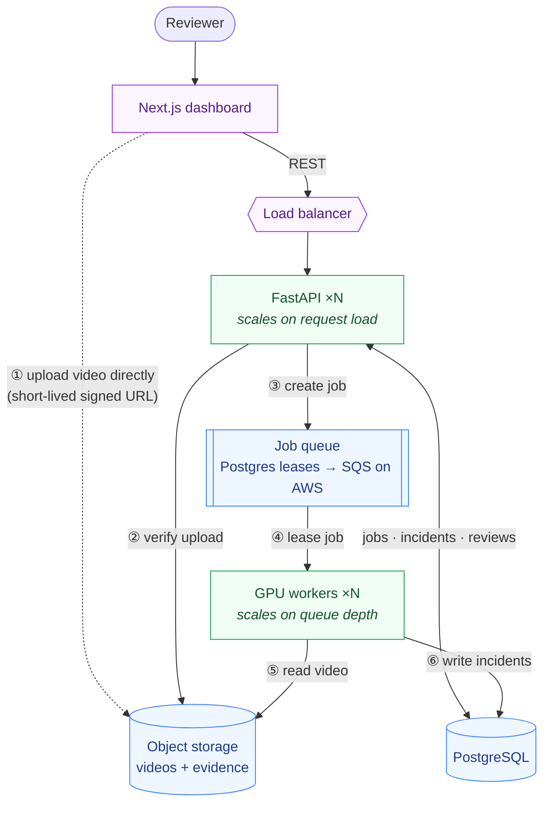
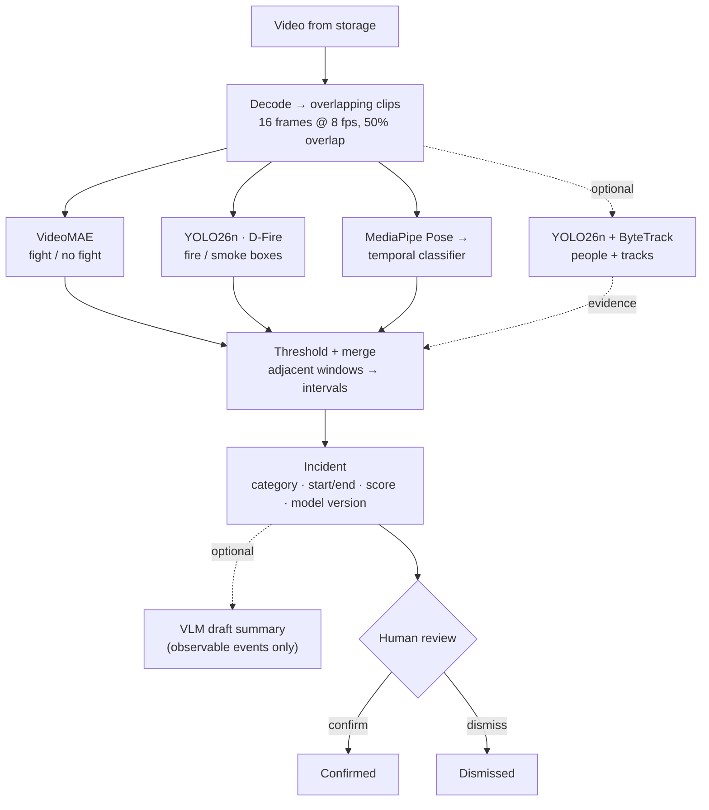
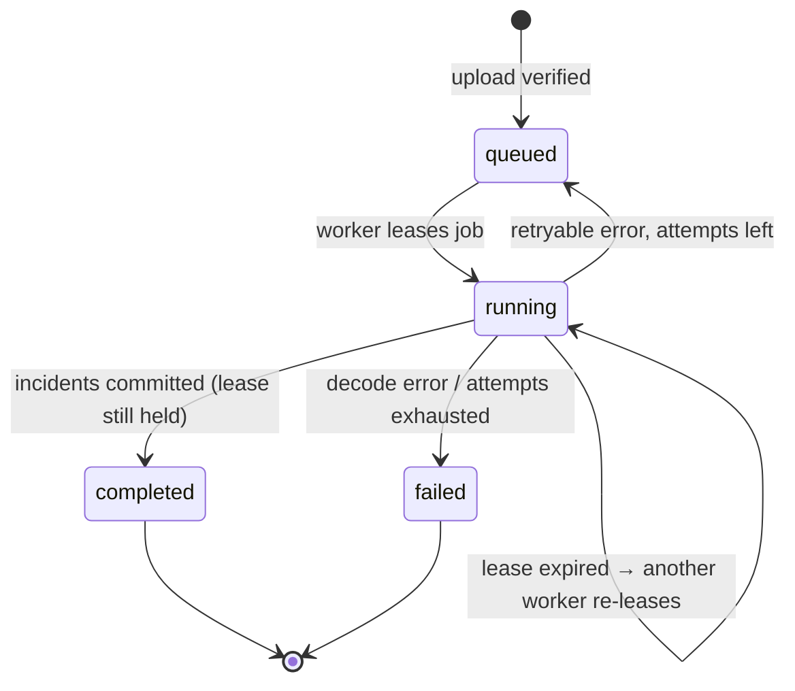

# HawkWatch

An incident-review assistant for uploaded security footage. Specialised computer-vision models flag *candidate* intervals (possible fights, visible fire/smoke, falls). A human reviewer confirms or dismisses each one.

Fine-tuned models, asynchronous GPU inference, and a backend where the API and the GPU workers scale independently.

> **Scope.** HawkWatch describes observable events; it does not accuse anyone of a crime. There is no face recognition, identity tracking, or automated dispatch. Use only footage you are authorised to process.

## System architecture



## Inference pipeline (inside a worker)



## Job lifecycle



A worker's commit is guarded by its lease token, and incidents are unique per `(job, category, start)`. A crashed or slow worker can't create duplicate incidents. See [docs/architecture.md](docs/architecture.md).

## Layout

| Path | What lives there |
| --- | --- |
| `web/` | Next.js dashboard: upload, job progress, incident timeline, review controls |
| `api/` | FastAPI service: signed uploads, job records, incidents, reviews |
| `worker/` | Python inference worker: leases jobs, runs models, writes incidents |
| `ml/` | Dataset manifests, training and evaluation code per incident type |
| `experiments/` | One-off scripts (e.g. the YOLO26n benchmark) |
| `infra/` | `compose.yaml` for local dev; `aws/` for staging/production |
| `tests/load/` | Load tests for the scale demo |
| `tasks/` | [Plan](tasks/plan.md) and [build checklist](tasks/todo.md) |
| `docs/` | Architecture notes and decision records |

## Quick start (local)

Requires Docker, Node 20+, Python 3.12 and [uv](https://docs.astral.sh/uv/).

```bash
cp .env.example .env
docker compose -f infra/compose.yaml up -d          # Postgres + S3-compatible storage
cd api && uv sync && uv run python -m app.dev_bootstrap && uv run alembic upgrade head
uv run fastapi dev app/main.py                      # http://localhost:8000/docs
cd worker && uv sync && uv run python -m worker
cd web && npm install && npm run dev                # http://localhost:3000
```

Milestone 1, the person-detection benchmark:

```bash
uv run --with ultralytics python experiments/run_yolo.py data/demo/Fighting0.mp4
# → runs/yolo26n/Fighting0.mp4 (annotated) + Fighting0.benchmark.json
```

## Datasets

Datasets are **never committed**. Download them into `data/` (git-ignored) and record provenance and usage terms in `ml/data/manifests/` before training. See [ml/README.md](ml/README.md).

| Dataset | Use | Notes |
| --- | --- | --- |
| RWF-2000 | Fight clip classification | Non-commercial; no redistribution |
| D-Fire | Fire/smoke detection | Check component licences |
| UR Fall | Fall detection pilot | Small; benchmark only |
| UCF-Crime | Later: temporal localisation | Disturbing content; controlled subset |
