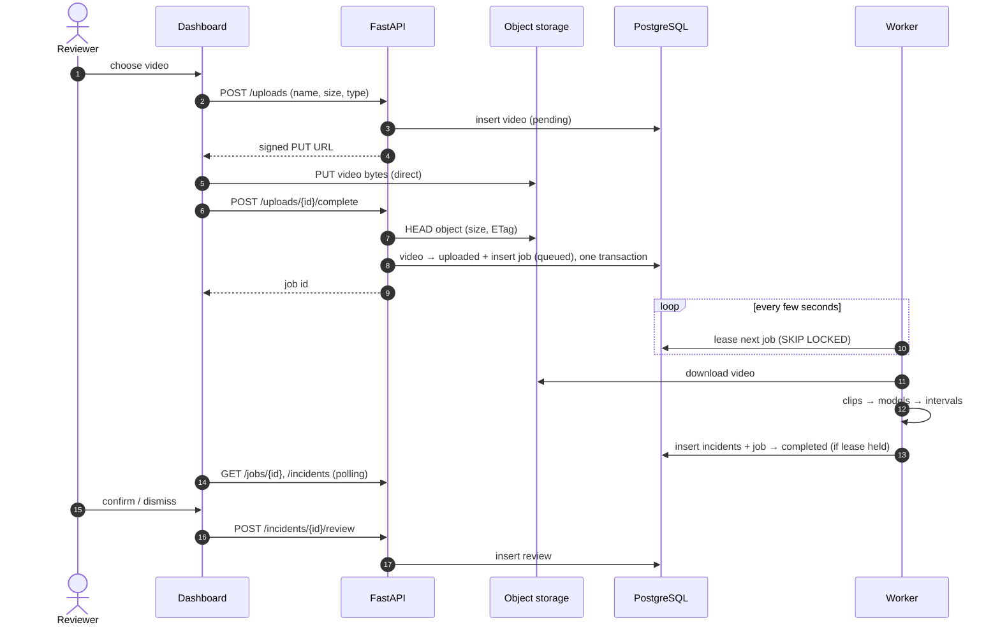
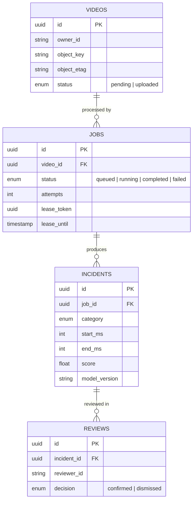

# Architecture

## Upload and processing sequence

## Data model

## Request flow

1. The dashboard calls `POST /uploads` with filename, size and content type. The API creates a `videos` row (`pending`) and returns a short-lived signed `PUT` URL.
2. The browser uploads directly to private object storage. Video bytes never pass through the API.
3. The dashboard calls `POST /uploads/{id}/complete`. The API `HEAD`s the object, checks size and owner, records its ETag/version, and in the **same transaction** inserts a `jobs` row (`queued`).
4. A worker leases a job (`SELECT … FOR UPDATE SKIP LOCKED`, sets `lease_until`), renews the lease while running, and writes incidents.
5. The dashboard polls `GET /jobs/{id}` and `GET /jobs/{id}/incidents`; the reviewer posts a decision to `POST /incidents/{id}/review`.

## Delivery guarantees

- **At-least-once processing.** A crashed worker's lease expires and another worker picks the job up. `attempts` is bounded by `WORKER_MAX_ATTEMPTS`; then the job is `failed`.
- **Exactly-once results.** Incidents carry a unique key `(job_id, category, start_ms)` and are written in one transaction with the job's `completed` transition, guarded by the lease token. A stale worker's commit is rejected.
- **Immutable input.** Each job pins the object key and ETag verified at step 3.

## Scaling (AWS)

| Component | Local | AWS | Scales on |
| --- | --- | --- | --- |
| API | `fastapi dev` | ECS Fargate ×2 behind ALB | CPU / request count |
| Queue | Postgres leases | SQS + DLQ, published via outbox table | — |
| Worker | `python -m worker` | ECS on EC2 GPU | SQS backlog per task, oldest message age |
| Storage | MinIO | S3 (private, SSE) | — |
| DB | Postgres 17 | RDS Postgres | — |
| Cache | — | ElastiCache Redis, only once read load is measured | — |

## Responsible-use constraints

- Outputs are *candidates* for human review, worded as observable events.
- No face recognition, identity linking, or automated dispatch.
- Evidence access is scoped to the uploading organisation and audited; retention is configurable and deletion is tested.
